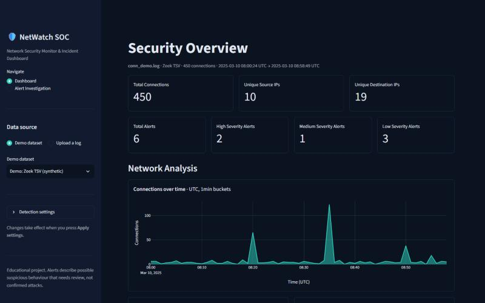
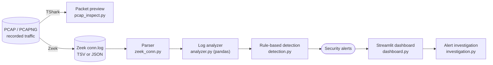
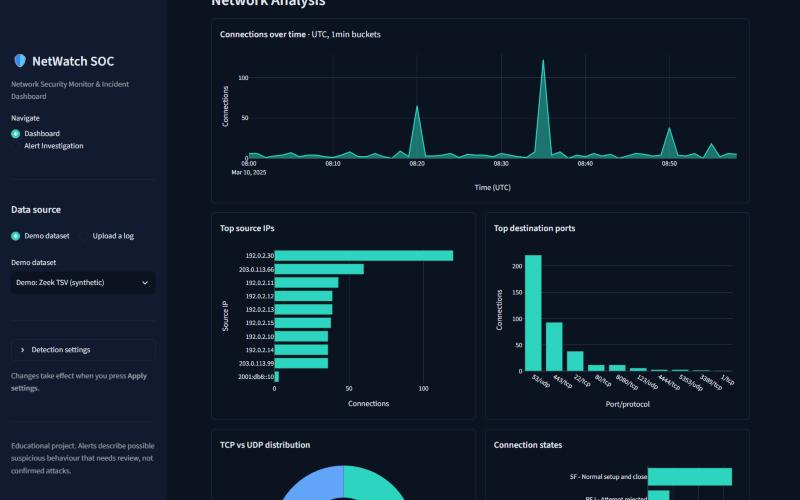
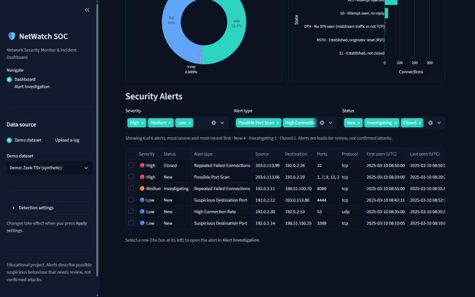
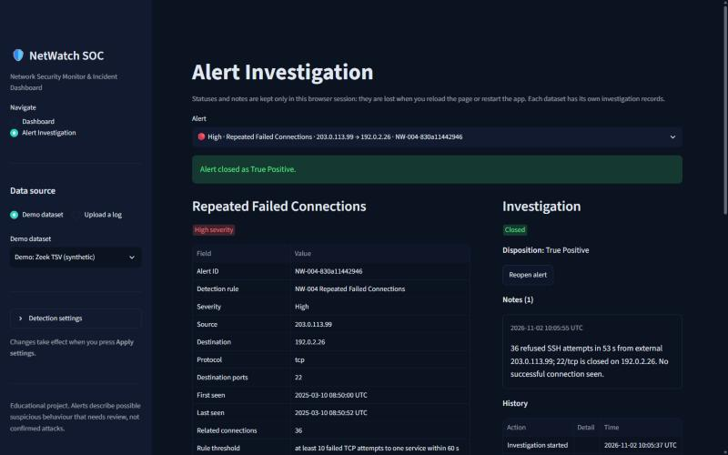

# NetWatch SOC: Network Security Monitor & Incident Dashboard

NetWatch SOC analyses **recorded** network traffic the way a Security
Operations Centre (SOC) analyst would: it turns Zeek connection logs into a
clean dataset, runs transparent detection rules, and presents the resulting
alerts in a dashboard with an investigation workflow.

It is an educational portfolio project built step by step by a Computer
Engineering graduate preparing for Junior SOC Analyst, Cybersecurity Trainee
and IT Security roles. Everything runs offline on your own computer, and a
synthetic demo dataset lets you try it without any real capture.



> **Scope:** NetWatch SOC analyses files you already have. It does not
> capture live traffic, scan networks, generate attacks or block anything.
> Its alerts describe *possible* suspicious behaviour for a human to review,
> not confirmed attacks.

## Contents

- [Architecture](#architecture)
- [Features](#features)
- [Quick start (Windows)](#quick-start-windows)
- [Prerequisites: TShark and Zeek](#prerequisites-tshark-and-zeek)
- [Command-line tools](#command-line-tools)
- [Dashboard](#dashboard)
- [Detection rules](#detection-rules)
- [Example workflow](#example-workflow)
- [Screenshots](#screenshots)
- [Testing](#testing)
- [Security and privacy](#security-and-privacy)
- [Limitations](#limitations)
- [Roadmap](#roadmap)
- [Learning objectives](#learning-objectives)
- [Project structure](#project-structure)

## Architecture



1. **Packets.** Wireshark/TShark show individual packets. `pcap_inspect.py` previews a capture.
2. **Connections.** Zeek summarises packets into one line per connection (`conn.log`).
3. **Parsing.** `zeek_conn.py` reads TSV or JSON logs, validates every
   field and skips bad lines, reporting each one.
4. **Analysis.** `analyzer.py` builds a typed pandas DataFrame and computes
   statistics: top talkers, ports, protocols, states, bytes and a timeline.
5. **Detection.** `detection.py` applies four deterministic rules and
   explains every alert from the data and the thresholds.
6. **Dashboard and investigation.** `dashboard.py` shows KPIs, charts and
   alerts. Analysts move alerts through New → Investigating → Closed.

Details: [docs/ARCHITECTURE.md](docs/ARCHITECTURE.md).

## Features

| Area | What you get |
|------|--------------|
| PCAP inspection | Readable packet preview via TShark: time (UTC), IPs, protocol, ports, length. Handles ICMP/ARP and missing fields |
| Zeek parsing | TSV and JSON `conn.log` → identical validated records. Strict checks on IPs, ports, counts and text fields. Bad lines reported with line numbers |
| Traffic analysis | pandas statistics: totals, unique IPs, TCP/UDP mix, top sources, top destination ports, connection states, bytes, durations, connections over time |
| Detection | Possible port scan, high connection rate, watchlisted destination port, repeated failed connections. Configurable thresholds, sliding windows, stable alert IDs, documented false positives |
| Dashboard | Dark SOC-style Streamlit app: KPI cards, five Plotly charts, filterable alerts table, uploads, detection settings |
| Investigation | Alert details, rule explanation, supporting connections, status workflow, notes, closure dispositions, history |
| Demo data | 450 synthetic connections (TSV + JSON) with six scenarios, built from documentation-only IP addresses |
| Quality | Unit, integration and headless UI tests. Deterministic results. No secrets or real traffic in the repository |

## Quick start (Windows)

You need **Python 3.11 or newer** (tested with 3.12; pandas 3 and
Streamlit require 3.11+) and Git. In PowerShell:

```bash
git clone https://github.com/hummamyassin/netwatch-soc.git
```

```bash
cd netwatch-soc
```

Create a virtual environment (a private folder for this project's
packages), then install pandas, Streamlit and Plotly into it:

```bash
python -m venv .venv
```

```bash
.venv\Scripts\python -m pip install -r requirements.txt
```

Run the tests, then start the dashboard with the built-in demo data:

```bash
.venv\Scripts\python -m unittest
```

```bash
.venv\Scripts\python -m streamlit run dashboard.py
```

Your browser opens <http://localhost:8501>. Stop the dashboard with
`Ctrl+C` in the terminal.

> Tip: activate the environment once per terminal with
> `.venv\Scripts\Activate.ps1` and you can type `python` and `streamlit`
> directly. If PowerShell blocks the script, keep using the
> `.venv\Scripts\python ...` form shown above. On macOS/Linux use
> `.venv/bin/python` and `source .venv/bin/activate`.

## Prerequisites: TShark and Zeek

Both are **optional**. The dashboard, analyzer and detection work on the
bundled demo data without them.

**TShark** (for `pcap_inspect.py`) comes with Wireshark:

- **Windows:** install Wireshark from <https://www.wireshark.org/download.html>
  (keep the TShark component ticked; Npcap is only needed for live capture,
  which this project does not do), or run `winget install WiresharkFoundation.Wireshark`.
  The tool also finds `C:\Program Files\Wireshark\tshark.exe` when it is not on `PATH`.
- **Ubuntu/Debian:** `sudo apt install tshark` (answer *No* to letting
  non-superusers capture packets). **macOS:** `brew install wireshark`.
- Check: `tshark --version`.

**Zeek** (to turn your own PCAPs into `conn.log`) has no official native
Windows build. Use **WSL2** (Ubuntu) or a Linux VM and follow
<https://docs.zeek.org/en/master/install.html>. Then, in an empty folder:

```bash
zeek -C -r capture.pcap
```

`-r` reads a file (no live capture) and `-C` ignores bad checksums, which
are common in captures. Zeek writes `conn.log` (and `dns.log`, `http.log`,
...) into the folder. For JSON output add `LogAscii::use_json=T`. Keep real
logs in `data/zeek_logs/` and real captures in `data/pcaps/`. Git ignores both.

**Training captures:** use trusted sources such as the
[Wireshark sample captures](https://wiki.wireshark.org/SampleCaptures)
(small, well labelled, a good start) or the curated list at
[Netresec](https://www.netresec.com/?page=PcapFiles). Malware captures
(e.g. Malware-Traffic-Analysis.net) are password-protected ZIPs for a
reason: only open them in an isolated lab VM.

## Command-line tools

```bash
python -m netwatch.pcap_inspect data/pcaps/capture.pcapng --limit 15
```

```bash
python -m netwatch.zeek_conn data/demo/conn_demo.log --limit 10
```

```bash
python -m netwatch.analyzer data/demo/conn_demo.log --top 5
```

```bash
python -m netwatch.detection data/demo/conn_demo.log
```

```bash
python -m netwatch.detection data/demo/conn_demo.log --scan-ports 50 --rules NW-001,NW-004
```

Sample output and an explanation of every column: [docs/USAGE.md](docs/USAGE.md).

## Dashboard

```bash
streamlit run dashboard.py
```

- **Sidebar:** choose the demo dataset (TSV or JSON) or upload your own Zeek
  `conn.log` (`.log`, `.json`, `.tsv`, `.txt`, up to 20 MB), adjust every
  rule's thresholds and press **Apply settings**, and switch pages.
- **Dashboard page:** KPI cards (connections, unique source and destination
  IPs, alerts by severity), connections over time, top source IPs, top
  destination ports, TCP vs UDP, connection states, and the **Security
  Alerts** table with severity, type and status filters.
- **Alert Investigation page:** select a row in the alerts table and press
  **Investigate** (or pick an alert). Review the details, the rule's
  explanation and false positives and the supporting connections, then
  record your work:

```
New ──Start investigation──► Investigating ──Close (with disposition)──► Closed
                                   ▲                                       │
                                   └──────────────── Reopen ───────────────┘
```

Dispositions: **True Positive**, **False Positive**, **Benign / Expected
Activity**, **Inconclusive**. Notes and status changes are timestamped (UTC)
in the case history.

> **Investigation state is not durable.** It lives in Streamlit's session
> state, in memory, and is lost when you reload the page or restart the app.
> There is deliberately no database yet. Records are kept separately per
> dataset (by file hash), so notes never mix between logs.

## Detection rules

| ID | Alert type | Triggers when (default settings) | Severity |
|----|------------|----------------------------------|----------|
| NW-001 | Possible Port Scan | one source contacts ≥ 15 distinct ports on the same host within 60 s | Medium (High at ≥ 45) |
| NW-002 | High Connection Rate | one source starts ≥ 100 connections within 60 s | Low (Medium at ≥ 300) |
| NW-003 | Suspicious Destination Port | traffic reaches a watchlisted port (23, 3389, 4444, 5900, 6667, 31337) | Low (contextual only) |
| NW-004 | Repeated Failed Connections | ≥ 10 rejected/unanswered TCP attempts to one service within 60 s | Medium (High at ≥ 30) |

- **Deterministic and explainable:** same log + same settings = same alerts
  and the same alert IDs. Every alert states what was measured, against which
  threshold, and lists its supporting connections. No AI decides anything.
- **Careful with missing data:** only TCP `S0`/`REJ`/`RSTOS0`/`SH` count as
  failed attempts. Normal, missing or UDP states never do.
- **Windows:** sliding and inclusive. Overlapping bursts merge into one
  alert, and input order does not matter.
- **False positives** are documented per rule: vulnerability scanners, busy
  proxies, admin RDP sessions, clients retrying a dead server...

Full reference: [docs/DETECTION_RULES.md](docs/DETECTION_RULES.md).

## Example workflow

1. **Get traffic:** download a training PCAP (see above) into `data/pcaps/`
   and preview it: `python -m netwatch.pcap_inspect data/pcaps/http.cap`.
2. **Make logs:** in WSL, run `zeek -C -r http.cap` and copy `conn.log` to `data/zeek_logs/`.
3. **Summarise:** `python -m netwatch.analyzer data/zeek_logs/conn.log`. Who
   talks most, on which ports, and how do connections end?
4. **Detect:** `python -m netwatch.detection data/zeek_logs/conn.log`, or
   open the dashboard and upload the log.
5. **Triage:** open each alert, check the supporting connections, add notes
   and close it with a disposition. For example, in the demo data the
   8080 retries are probably *Benign / Expected Activity* (a client retrying
   a dead server), while 36 refused SSH attempts from an external host are a
   likely *True Positive*.
6. **Tune:** if an alert is a false positive, adjust its threshold or
   watchlist in **Detection settings** and see what changes.

No capture handy? Steps 3–6 work on `data/demo/conn_demo.log`; its six
scenarios are described in [data/demo/README.md](data/demo/README.md).

## Screenshots

All screenshots show the synthetic demo dataset.

| Network analysis | Security alerts |
|---|---|
|  |  |



## Testing

```bash
python -m unittest -v
```

The suite covers parsing (TSV/JSON parity, malformed and hostile input,
CRLF/BOM), analysis (types, UTC, missing values, empty data, deterministic
ordering), detection (positive, negative, boundary, overlapping windows,
unsorted and duplicated input, a pinned alert-ID regression, the demo
end to end), the investigation workflow, dashboard data preparation, the
real Streamlit app run headlessly with `AppTest` (including simulated
uploads), and an end-to-end integration path. Tests that need TShark are
skipped automatically when it is not installed. No test needs Zeek or
network access.

## Security and privacy

- **Offline by design:** reads files only. No live capture, scanning or
  traffic generation, and nothing needs administrator rights.
- **Untrusted input:** packet data and logs are parsed as data and never
  executed. Uploads are checked (extension allow-list, 20 MB limit, PCAP and
  binary files refused), parsed in memory and never written to disk. Their
  names are used only as labels.
- **Strict parsing:** text fields must match Zeek's own character set, so
  terminal escape codes or Markdown links in a crafted log are rejected.
  File-derived text shown as Markdown is escaped, and notes are shown as plain text.
- **Safe subprocess use:** TShark runs from an argument list (no shell),
  with `-n` (no DNS lookups) and a timeout.
- **Local only:** the dashboard listens on `localhost` and Streamlit's usage
  statistics are off (`.streamlit/config.toml`).
- **No sensitive data in Git:** `.gitignore` blocks captures, logs, `.env`
  and Streamlit secrets. The only tracked logs are synthetic and use
  documentation-only addresses (192.0.2.0/24, 198.51.100.0/24,
  203.0.113.0/24, 2001:db8::/32).

## Limitations

- **Connection metadata only:** no payload inspection, no `dns.log`/`http.log`
  analysis yet, and no detection of attacks that look like normal connections.
- **Simple rules with demonstration thresholds:** a real network needs
  tuning, allow-lists and more context (asset inventory, threat intelligence).
- **No persistence:** investigation notes are lost on reload or restart.
  There are no users, roles or authentication. The dashboard is for local use only.
- **Zeek is not bundled:** creating your own `conn.log` needs Zeek on Linux/WSL.
- **Scale:** the dashboard targets logs up to 20 MB. Very large logs would
  need streaming or a database.
- **Not a production security tool:** it is a learning and portfolio project.

## Roadmap

| # | Milestone | Status |
|---|-----------|--------|
| 1 | Networking, PCAP, Wireshark: packet preview with TShark | ✅ Done |
| 2 | Zeek logs: TSV/JSON `conn.log` parser | ✅ Done |
| 3 | Python log analysis with pandas | ✅ Done |
| 4 | Deterministic detection rules | ✅ Done |
| 5 | Streamlit SOC dashboard | ✅ Done |
| 6 | Alert investigation workflow | ✅ Done |
| 7 | Optional AI explanations (Gemini *explains* existing alerts, never decides them) | ⏳ Not started (optional) |
| 8 | Testing and GitHub polish | ✅ Done |

Ideas beyond the roadmap: durable case storage (e.g. SQLite), allow-lists
for known scanners, more Zeek logs (`dns.log`, `http.log`, `ssl.log`), and
exporting an investigation report.

## Learning objectives

- Read packets with Wireshark/TShark and explain IPs, ports, protocols and the TCP handshake.
- Understand how Zeek summarises traffic into connection logs, and what
  `conn_state` and `history` reveal.
- Parse and validate untrusted input safely in Python.
- Analyse logs with pandas without misleading results (missing ≠ zero, UTC, deterministic order).
- Design detection rules with thresholds and time windows, and reason
  about false positives and severity.
- Build a small, testable Streamlit application and practise alert triage.

The concepts learned along the way are written up in
[docs/LEARNING_LOG.md](docs/LEARNING_LOG.md).

## Project structure

```
netwatch/
  pcap_inspect.py       Packet preview with TShark (stdlib only)
  zeek_conn.py          Zeek conn.log parser, TSV + JSON (stdlib only)
  analyzer.py           pandas DataFrame + traffic statistics
  detection.py          Rule-based detection engine (NW-001..NW-004)
  investigation.py      Triage workflow: statuses, notes, dispositions
  dashboard_data.py     Data preparation for the dashboard (no UI code)
dashboard.py            Streamlit user interface
.streamlit/config.toml  Local-only, no telemetry, dark theme
scripts/generate_demo_data.py  Rebuilds the synthetic demo data (fixed seed)
data/demo/              Synthetic demo dataset (tracked)
data/pcaps/, data/zeek_logs/   Your own captures and logs (ignored by Git)
tests/                  Unit, integration and headless UI tests + synthetic fixtures
docs/
  ARCHITECTURE.md       Modules, data flow, design decisions
  DETECTION_RULES.md    Rule logic, severity, false positives, tuning
  USAGE.md              Command-line guide with sample output
  LEARNING_LOG.md       Concepts learned, milestone by milestone, and a glossary
  screenshots/          Dashboard screenshots (synthetic data)
CLAUDE.md               Project rules for the AI coding assistant
```
