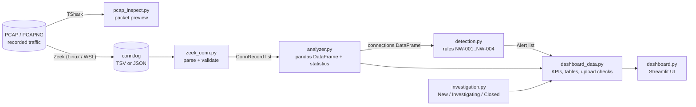

# Architecture

NetWatch SOC is a small pipeline. Each stage is a plain Python module with
one job, and data flows in one direction:



## Modules

| Module | What it does | Why it exists | Depends on |
|--------|--------------|---------------|------------|
| `netwatch/pcap_inspect.py` | Runs TShark on a capture file and prints time, IPs, protocol, ports and length per packet | Learn what raw traffic looks like before it is summarised | Python stdlib, TShark |
| `netwatch/zeek_conn.py` | Parses Zeek `conn.log` (TSV or JSON) into validated `ConnRecord`s; skips and reports bad lines | Zeek logs are the main input; one strict parser protects everything downstream from malformed or hostile data | Python stdlib |
| `netwatch/analyzer.py` | Turns `ConnRecord`s into a typed pandas DataFrame and computes statistics (top talkers, ports, protocols, states, bytes, timeline) | Answers "what is normal here?" and gives detection a clean table to work on | pandas, `zeek_conn` |
| `netwatch/detection.py` | Applies four deterministic rules and produces `Alert`s with stable IDs, severity, thresholds, explanations and supporting event IDs | The security logic: explainable decisions, no AI | pandas, `analyzer` |
| `netwatch/investigation.py` | Records the triage workflow per alert: status, notes, disposition, history | Turns alerts into decisions an analyst can document | Python stdlib |
| `netwatch/dashboard_data.py` | Prepares everything the dashboard shows: upload checks, dataset loading, KPIs, chart data, alert tables, filters, escaping | Keeps logic out of the UI so it can be unit-tested | pandas, the modules above |
| `dashboard.py` | The Streamlit user interface: sidebar, dashboard page, investigation page | Presentation only | Streamlit, Plotly, `dashboard_data` |
| `scripts/generate_demo_data.py` | Writes the synthetic demo dataset and the normal-traffic fixture | Reproducible, documentation-safe data for demos and tests | Python stdlib |

The two lowest layers (`pcap_inspect`, `zeek_conn`) use only the standard
library, so they work without installing anything. `investigation.py` also
has no Streamlit dependency and can be reused by any other interface.

## Data model

```
conn.log line ──► ConnRecord ──► DataFrame row ──► Alert ──► Case
               (zeek_conn)    (analyzer)        (detection) (investigation)
```

- **`ConnRecord`** (`zeek_conn`): one connection, with validated values and
  `None` for anything Zeek did not record. TSV and JSON produce identical records.
- **Connections DataFrame** (`analyzer`): one row per *unique* connection.
  Fixed column types: `ts` is `datetime64[us, UTC]`, ports and counts are
  nullable `Int64`, `duration` is `Float64`. Each row has an `event_id`:
  the Zeek `uid`, or `row-N` when the log has none.
- **`Alert`** (`detection`): rule, severity, source/destination, ports,
  protocols, first/last seen, counts, threshold, window, explanation and the
  `event_id`s of the supporting connections. Its `alert_id` is a SHA-256
  fingerprint of the rule and those events, so the same data and settings
  always give the same ID.
- **`Case`** (`investigation`): status, disposition, notes and history for
  one `alert_id`, stored in an `InvestigationStore` for one dataset.

## How the dashboard uses the modules

1. The file (demo or upload) is checked (`dashboard_data.check_upload`,
   `decode_log_bytes`), parsed **in memory** (`zeek_conn.parse_conn_text`)
   and turned into a DataFrame (`analyzer.build_loaded_log`). The dataset ID
   is a SHA-256 hash of the file content.
2. `detection.run_detection` runs with the settings from the sidebar.
3. Parsing and detection results are **cached** (`st.cache_data`), keyed on
   the file hash and the settings, so clicking around never re-parses the log.
4. KPIs, chart data and the alerts table come from `dashboard_data`, which
   calls the analyzer and detection functions. The UI does no computing of its own.
5. Investigation state lives in `st.session_state["investigations"]`: one
   `InvestigationStore` per dataset ID. It is in memory only and lost on
   reload or restart.

## Design decisions

| Decision | Reason |
|----------|--------|
| Rule-based, deterministic detection | Every alert can be explained and reproduced. AI may later *explain* alerts but never decide them |
| Validate at the edge (parser) | IPs, ports, counts and text fields are checked once. Everything later can trust the data, and hostile strings never reach the UI |
| Missing ≠ zero | `None`/`<NA>` stay missing. Totals report coverage, and rules never treat a missing state as a failure |
| Sort before windows | Zeek writes `conn.log` in end-time order, so rules sort by start time and results never depend on line order |
| Stable IDs from content | Alert IDs and dataset IDs are hashes, so notes reattach after re-running and never mix between files |
| Logic outside the UI | `dashboard_data.py` and `investigation.py` are unit-tested. `dashboard.py` is also tested end to end with Streamlit's `AppTest` |
| No database, no Docker, no cloud | Keep the project small and understandable. Investigation state is explicitly non-durable |
| Local-only dashboard | `.streamlit/config.toml` binds to `localhost` and disables usage statistics |

## Testing strategy

| Test file | Covers |
|-----------|--------|
| `tests/test_pcap_inspect.py` | Argument validation, TShark command safety, parsing, error handling; real-TShark tests on synthetic captures (skipped without TShark) |
| `tests/test_zeek_conn.py` | TSV/JSON parsing, converters, whole-file errors, bad lines, hostile text, CRLF/BOM |
| `tests/test_analyzer.py` | DataFrame types, UTC, duplicates, empty data, every statistic, deterministic order |
| `tests/test_detection.py` | Every rule: positive, negative, boundary (threshold and window edge), overlap merging, unsorted input, duplicates, regression-pinned alert ID, demo end to end |
| `tests/test_investigation.py` | Workflow transitions, notes, dispositions, atomic failures, per-dataset isolation |
| `tests/test_dashboard_data.py` | Upload checks, in-memory loading, KPIs, chart data, alert tables and filters, escaping |
| `tests/test_dashboard_app.py` | The real Streamlit app, headless: KPIs, filters, settings, uploads (valid, garbage, PCAP, partial, empty), investigation workflow |
| `tests/test_integration.py` | Synthetic log → parser → analyzer → detection → dashboard data → investigation |
